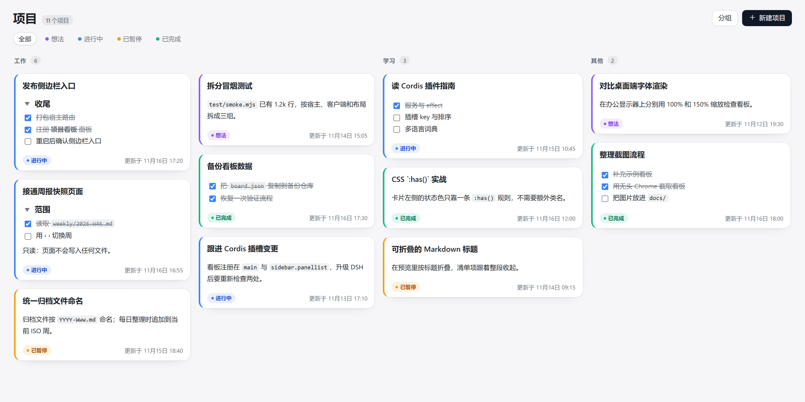

# dsh-plugin-kanban

给 DeepSeek Harness 侧边栏用的项目看板：把 Markdown 项目卡片按分组排进多列，列数随窗口自适应，支持清单和可折叠标题。

**简体中文** | [English](README.en.md)



本 README 是部署指南。插件没有运行时依赖，也没有构建步骤；`lib/` 就是发布代码。

## 环境要求

- DeepSeek Harness 桌面版（插件会安装到 `desktop` profile）
- 只有跑测试时才需要 Node.js 20.11+（用到 `import.meta.dirname`）；运行时的 React 由 DSH 提供

## 安装

推荐用插件管理器（界面或 `plugin_manager` 工具）把这个目录作为 bundle 安装：

```text
plugin_manager install_bundle C:\path\to\dsh-kanban
```

或者用命令行：

```bash
dsh plugin --profile desktop add C:\path\to\dsh-kanban
```

两种方式都会在 profile 里写入指向本目录的 `link:` 依赖，并把 `dsh-plugin-kanban` 加进 `dsh.profile.bundles`，所以之后替换目录即可完成升级。

手动安装：在 `~/.dsh/profiles/desktop/package.json` 的 dependencies 里加上下面一行，并把包名追加到 `dsh.profile.bundles`：

```json
"dsh-plugin-kanban": "link:C:/path/to/dsh-kanban"
```

## 安装或升级后：重启一次

插件还有一个负责读写看板文件的宿主部分。重启 DeepSeek Harness 后它才会加载；在此之前，看板会显示一条提示，你的改动只保留在当前窗口里，等宿主下次重启后再写入文件。

## 验证

1. 左侧边栏出现 **Kanban**（项目看板）入口。
2. 打开它，点击 **新建项目**，写点 Markdown，然后保存。
3. 页头有 **分组**（可重命名/添加/删除分组）和状态筛选。
4. 看板保存到 `$DSH_HOME/kanban/board.json`（默认 `~/.dsh/kanban/board.json`）。如果看板很重要，升级前先备份这个文件。
5. 在 **已完成** 状态停留 3 天且没有编辑的项目，会移到 `$DSH_HOME/kanban/archive/` 下的每周 Markdown 记录里（见下文）。

## 示例数据

`examples/` 里有两份可以直接使用的示例看板：`board.zh.json`（中文）和 `board.en.json`（英文）。两份都是 3 个分组、11 个项目，覆盖四种状态，以及标题、清单、引用、行内代码等 Markdown 写法；上方截图就是用 `board.zh.json` 渲染的。

想先看看效果，先备份原看板，再用示例覆盖：

```bash
cp ~/.dsh/kanban/board.json ~/.dsh/kanban/board.json.bak   # 先备份
cp examples/board.zh.json ~/.dsh/kanban/board.json
```

刷新看板即可。注意：示例里的「已完成」项目如果超过 3 天没有编辑，会被自动整理归档，这是正常行为。

## 自动整理

宿主部分运行期间，看板每天（按本地日期）自动整理一次：

- 项目在 **已完成** 状态停留 3 天且期间没有编辑（以 `updatedAt` 计）时，会从看板移除，并追加到当周的记录。
- 记录是 `$DSH_HOME/kanban/archive/` 下的 Markdown 文件，每个 ISO 周一个（如 `2026-W45.md`）。每条记录包含标题、最后编辑时间、创建时间、分组、归档时间和完整笔记，相当于一份每周完成事项日志。记录只追加：整理重试也不会把同一个项目记两次。
- 检查在宿主启动时、每 30 分钟，以及每次打开看板时进行；每天最多真正整理一次，DSH 关闭期间错过的那天会在下次启动时补上。
- `$DSH_HOME/kanban/automation.json` 记录上次运行时间和已归档项目的 id。这些 id 相当于墓碑，所以仍持有旧看板的浏览器无法在下次保存时把已清掉的项目写回来。
- 启动 DeepSeek Harness 前，在宿主环境里设置 `DSH_KANBAN_AUTOMATION=off`（也支持 `0`、`false`、`disabled`）可以关闭自动整理。
- 归档就是普通 Markdown：可以直接阅读、编辑，或备份到 DSH 之外。其他状态的项目不会被改动。

## 每周页面

`weekly-page/` 是一个配套的浏览器插件，用来查看每周进度快照。它读取本工作区的 `weekly/YYYY-Www.md`，显示最新一周，并用页头的 **‹ / ›** 按钮切换周。它和看板 bundle 分开安装（以 `@dsh-local/view-959dc1ec-…` 的形式链接进 `desktop` profile），并且从不写文件。

## 升级

```bash
git pull          # 或者直接替换目录
```

然后重启 DeepSeek Harness。用 `link:` 安装的无需重装；读取时，版本 1 的看板文件会自动迁移。

## 卸载

```text
plugin_manager remove_bundle dsh-plugin-kanban
```

或者：

```bash
dsh plugin --profile desktop remove dsh-plugin-kanban
```

看板文件会保留。想重置看板，删除 `~/.dsh/kanban/board.json` 即可。

## 常见问题

- **侧边栏没有入口**：确认 profile 的 `dsh.profile.bundles` 里有 `dsh-plugin-kanban`，并且该包能在 profile 的 `node_modules` 里解析；然后重启 DSH。
- **提示宿主部分版本过旧**：重启 DeepSeek Harness。
- **看板文件读不出来**：宿主会把损坏的文件移到一边，并以空看板启动；需要的话从备份恢复。
- **升级后页面没有加载**：重启一次 DSH；浏览器部分按应用启动缓存。

## 开发

```bash
npm install --ignore-scripts
node test/smoke.mjs            # 单元、组件和实际路由测试
node test/layout-harness.mjs   # 生成 .tmp/harness-{short,tall}.html
node test/editor-harness.mjs   # 生成 .tmp/editor.html（编辑器排版）
node tools/board-screenshot.mjs # 重新生成 docs/board.{zh,en}.png（需要本机 Chrome/Edge）
```

`lib/client.js` 是浏览器 bundle（通过 `window.__ModuleLoader__` 加载），`lib/index.js` 是宿主部分；没有编译步骤。截图脚本用示例数据和真实组件渲染看板，设置 `CHROME_PATH` 可以指定浏览器路径。
